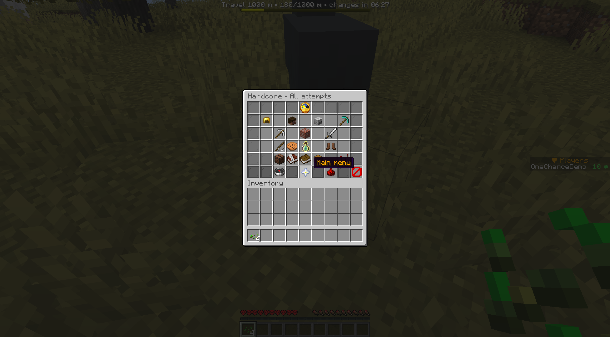
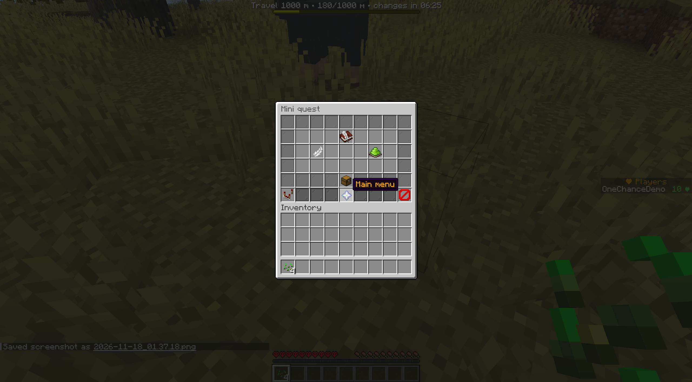
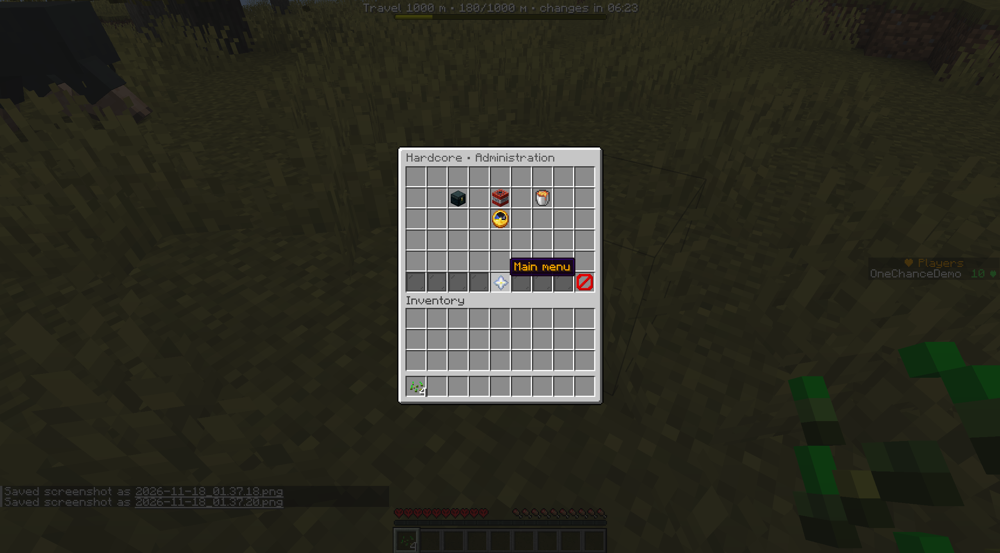
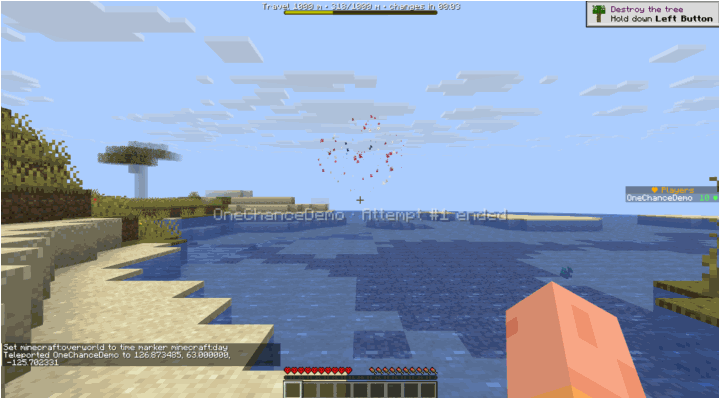
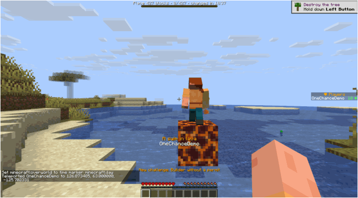
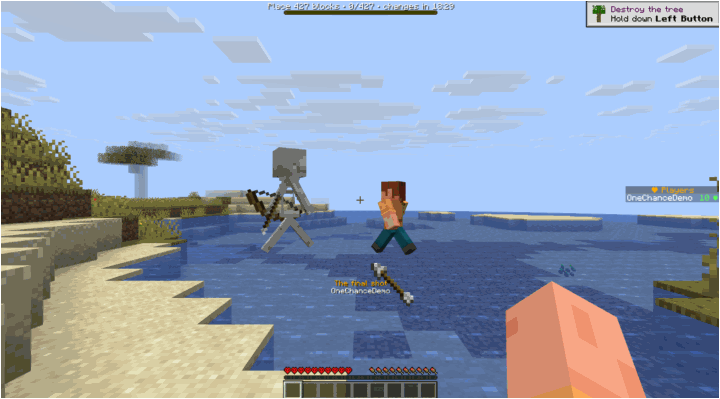

# OneChance — Один шанс

**Кооперативный хардкор для Minecraft Java Edition.** OneChance — серверный плагин Paper для пати друзей. У команды одна общая попытка: первая смерть любого игрока завершает забег. Сервер создаёт новый комплект миров, и вся группа начинает выживание заново.

**Co-op hardcore survival plugin for Paper.** One player death ends the whole party's run. OneChance regenerates the Overworld, Nether, and End, tracks shared hardcore attempts and player statistics, and saves backups for administrator rollback.

[Скачать на Modrinth](https://modrinth.com/plugin/one-chance) · [Настройки](resources/config.yml) · [Расширенная документация](README.txt)

## Как проходит попытка

1. Игроки вместе выживают в одном хардкорном забеге на сложности Hard.
2. Первая смерть завершает забег для всей пати. Плагин показывает причину, записывает результат и готовит резервную копию.
3. Группа переходит в новые миры. Для новой попытки сбрасываются инвентари, прогресс и незабранные награды. Рекорды и история забегов остаются доступны.

Плагин подходит для небольших серверов с друзьями, командных испытаний на выживание и Minecraft hardcore challenges. Для стабильной игры нужен сервер с хорошим процессором: после смерти приходится создать три мира, подготовить спавн и загрузить чанки. Скорость нового старта зависит от производительности процессора, генератора, дальности прорисовки и других плагинов.

## Возможности

- **Меню и статистика.** Просмотр текущей попытки, истории, рекордов, личных профилей и рейтингов игроков.
- **Мини-задания.** Персональные задания с прогрессом на босс-баре и отдельным хранилищем шуточных наград.
- **Эффекты смерти и прибытия.** Настраиваемые сообщения по причинам смерти, звуки, частицы и миниатюры на версиях Paper с API манекенов. На остальных версиях доступен экран с частицами.
- **Резервные копии.** Администратор выбирает готовый снимок попытки и подтверждает откат. Восстановление выполняется при следующем запуске сервера.
- **Оформление.** Русский, английский, украинский и испанский языки. Конфиг позволяет менять заголовки, иконки, описания и позиции кнопок.
- **Здоровье.** Встроенная индикация сердец и интеграция с TAB через PlaceholderAPI.

## Скриншоты

Снято в Minecraft Java Edition 26.3 на локальном Paper-сервере с OneChance 2.0.1.

| Главное меню | Мини-задание | Меню администратора |
| --- | --- | --- |
|  |  |  |

### Эффекты при смерти

GIF записаны во встроенном предпросмотре OneChance на Paper 26.3. Предпросмотр показывает сцену и частицы без запуска новой попытки.

| Экран завершения | Смерть в лаве | Попадание стрелы |
| --- | --- | --- |
|  |  |  |
| /hcr deathtest | /hcr scenetest lava | /hcr scenetest projectile |

## Установка

Проверенные версии Minecraft на **Paper**: **1.21.1**, **1.21.4–1.21.11**, **26.1.2**, **26.2**, **26.3**. Используйте Java, которую требует выбранная сборка Paper. На клиенте достаточно обычного Minecraft Java Edition. Сборка использует Paper API и требует сервер Paper.

1. Остановите сервер и положите JAR в папку plugins.
2. Запустите сервер. Для новой установки настройки лежат в plugins/OneChance/config.yml.
3. Выберите язык в поле language. Допустимые значения — ru, en, uk, es. Примените настройки перезапуском сервера.

При обновлении с HardcoreReset замените старый JAR и сохраните папку plugins/HardcoreReset. Переименованная сборка продолжит работать с ней. Для нового сервера используется папка plugins/OneChance.

## Команды

| Команда | Назначение |
| --- | --- |
| /hcr, /stats | Главное меню и статистика |
| /try, /survived | Номер попытки и время выживания |
| /quest, /hcr rewards | Текущее задание и хранилище наград |
| /hcr history [номер] | История и сведения о конкретной попытке |
| /hcr deathtest, /hcr scenetest list | Предпросмотр эффектов и список причин смерти |
| /hcr admin | Меню администратора |
| /hcr backups, /hcr rollback confirm | Список снимков и запрос восстановления последнего снимка |
| /hcr forcereset | Завершить текущую попытку и запустить новую |

Для администрирования требуется право hardcorereset.admin. По умолчанию оно есть у операторов сервера.

## Настройка меню и интеграций

В config.yml раздел menus меняет заголовок экрана, вид предметов и расположение кнопок. Слоты нумеруются от 0 до 53, а действие перемещается вместе с кнопкой. Разделы effects и death-screen управляют эффектами прибытия, подписями и сценами. Примеры доступны в [config.yml](resources/config.yml).

При установленном PlaceholderAPI доступны значения %hardcorereset_hp%, %hardcorereset_max_hp% и %hardcorereset_absorption%. Единица измерения — одно очко здоровья, то есть половина сердца. Для отображения в TAB используйте эти значения в конфигурации TAB.

## Сборка

Для сборки требуется JDK 25. Maven Wrapper скачивает Maven при первом запуске. На Windows запустите:

    .\mvnw.cmd -B package

На Linux и macOS:

    ./mvnw -B package

Готовый JAR создаётся в target/one-chance-2.0.1.jar. Пакет включает SQLite JDBC. Paper API и опциональный PlaceholderAPI предоставляются сервером.

**Темы поиска:** Minecraft hardcore plugin, multiplayer hardcore, co-op hardcore, shared hardcore run, party survival, world reset, Paper plugin, командный хардкор Minecraft, хардкор для пати, совместное выживание, сброс мира после смерти.
